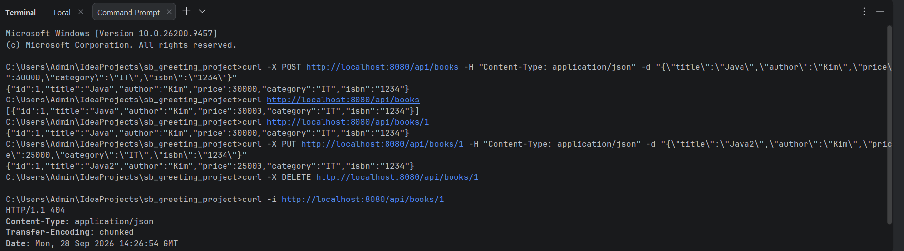

# Week04 Book CRUD

## 1. 프로젝트 소개

### 프로젝트 주제
Spring Boot로 만든 **도서(Book) 관리 REST API**다.
책을 등록, 조회, 수정, 삭제(CRUD)할 수 있다.

### 프로젝트 구조
```
src/main/java/org/example/week04
├── SbGreetingProjectApplication.java
├── controller
│   └── BookController.java
├── service
│   └── BookService.java
├── repository
│   ├── BookRepository.java
│   └── MemoryBookRepository.java
├── domain
│   └── Book.java
└── dto
    ├── BookRequest.java
    └── BookResponse.java
```

### API Endpoint
| Method | URL | 기능 |
|---|---|---|
| POST | /api/books | 등록 |
| GET | /api/books | 전체 조회 |
| GET | /api/books/{id} | 단건 조회 |
| PUT | /api/books/{id} | 수정 |
| DELETE | /api/books/{id} | 삭제 |

### Request JSON 예시
```json
{
  "title": "Java",
  "author": "Kim",
  "price": 30000,
  "category": "IT",
  "isbn": "1234"
}
```

### Response JSON 예시
```json
{
  "id": 1,
  "title": "Java",
  "author": "Kim",
  "price": 30000,
  "category": "IT",
  "isbn": "1234"
}
```

### 실행 방법
1. IntelliJ에서 `SbGreetingProjectApplication`을 실행한다.
2. Command Prompt에서 curl로 요청을 보낸다.

```
curl -X POST http://localhost:8080/api/books -H "Content-Type: application/json" -d "{\"title\":\"Java\",\"author\":\"Kim\",\"price\":30000,\"category\":\"IT\",\"isbn\":\"1234\"}"
curl http://localhost:8080/api/books
curl http://localhost:8080/api/books/1
curl -X PUT http://localhost:8080/api/books/1 -H "Content-Type: application/json" -d "{\"title\":\"Java2\",\"author\":\"Kim\",\"price\":25000,\"category\":\"IT\",\"isbn\":\"1234\"}"
curl -X DELETE http://localhost:8080/api/books/1
curl -i http://localhost:8080/api/books/1
```

### curl 테스트 결과

---

## 2. 이번 과제 키워드

REST API, CRUD, @RequestBody, @PathVariable, Layered Architecture, Repository Interface

---

## 3. 핵심 내용 정리

1. **REST API는 URL과 HTTP Method로 기능을 구분한다.** 같은 `/api/books/1`이라도 GET이면 조회, PUT이면 수정, DELETE면 삭제다.
2. **Controller, Service, Repository로 역할을 나눈다.** Controller는 요청과 응답만, Service는 로직만, Repository는 저장만 담당한다.
3. **Repository를 인터페이스로 만들면 저장 방식을 쉽게 바꿀 수 있다.** 지금은 Map에 저장하지만, 나중에 DB 구현체로 바꿔도 Service 코드는 그대로 둘 수 있다.
4. **@RequestBody는 JSON을 객체로 바꾸고, @PathVariable은 URL의 값을 꺼낸다.** `/api/books/1`에서 `1`이 id로 들어온다.

---

## 4. Weekly Report

### Key Learning
1. Layered Architecture로 계층마다 역할을 나누는 방법
2. Repository 인터페이스와 구현체를 분리하는 이유
3. @GetMapping, @PostMapping, @PutMapping, @DeleteMapping으로 CRUD API를 만드는 방법

### CRUD Flow
```
Client (POST /api/books)
  ↓
BookController : @RequestBody로 JSON을 BookRequest로 변환
  ↓
BookService : BookRequest를 Book으로 바꿈
  ↓
BookRepository (interface) : save() 호출
  ↓
MemoryBookRepository : id를 1 증가시키고 Map<Long, Book>에 저장
  ↓
BookResponse로 바꿔서 Client에게 응답
```

### Problem & Solution
- **문제**: Gradle 새로고침을 하자 `Cannot find a Java installation on your machine matching languageVersion=17` 에러가 났다.
- **해결**: 내 컴퓨터에 JDK 17이 없어서 생긴 문제였다. IntelliJ에서 JDK 17을 다운로드하고 다시 새로고침해서 해결했다.

### Code Review
BookService의 `findBook()` 메서드입니다.

```java
private Book findBook(Long id) {
    Optional<Book> result = bookRepository.findById(id);
    if (result.isEmpty()) {
        throw new ResponseStatusException(HttpStatus.NOT_FOUND, "책을 찾을 수 없습니다. id=" + id);
    }
    return result.get();
}
```

**이유**: 단건 조회, 수정, 삭제가 모두 이 메서드를 사용해서, 없는 id를 요청하면 세 기능 모두 똑같이 404를 반환하기 때문이다.

### Reflection
서버를 껐다 켜면 등록한 책이 모두 사라지는 것을 보고, Map은 메모리에만 저장된다는 것을 알게 되었다. 실제 DB는 어떻게 연결하는지 궁금하다.

### 건의사항
Postman과 curl을 처음 사용해 봐서 요청을 보내는 방법이 낯설었습니다. 수업 시간에 직접 Postman으로 POST, PUT 요청을 보내는 과정을 한 번 보고싶습니다.